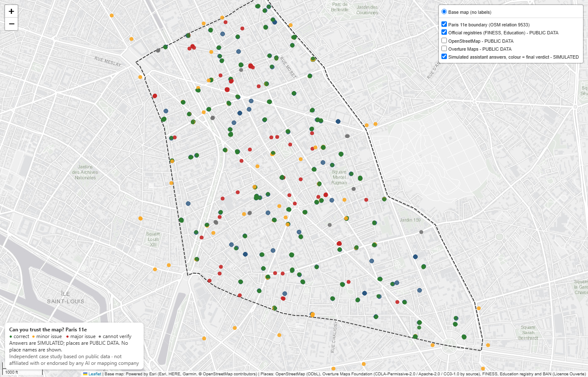

# Can you trust the map? Auditing AI-generated local answers in one Paris district

A short case study for an AI-training map & location QA role: checking addresses, place names and map positions produced by a (simulated) AI assistant, flagging false, outdated or misleading information, and writing annotation guidelines that give the same verdict whoever applies them.

**Area:** Paris 11e (OSM relation 9533, INSEE 75111) · **Themes:** pharmacies, schools, addresses · **Desk research only** (no field visit).
**PUBLIC DATA:** official registries (FINESS, Education registry, BAN) vs open databases (OpenStreetMap, Overture Maps). **SIMULATED:** 600 answers of a fictional local-search assistant (no LLM called, no answer attributed to any real product) and 3 simulated annotators.

| Deliverable | Link |
|---|---|
| Report (6 pages) | [report/Location_QA_audit_Paris11.pdf](report/Location_QA_audit_Paris11.pdf) |
| Interactive map (open locally in a browser) | [map/index.html](map/index.html) |
| QA workbook: taxonomy, rubric, audit log of 600 answers, agreement, summary | [qa/location_qa_workbook.xlsx](qa/location_qa_workbook.xlsx) |
| Annotation guidelines v2 (10 examples, 3 worked step by step) | [docs/annotation_guidelines.md](docs/annotation_guidelines.md) |
| Checklist per task (6 steps, under 2 minutes) | [docs/checklist_per_task.md](docs/checklist_per_task.md) |
| Error taxonomy · source reliability · data issues log | [docs/error_taxonomy.md](docs/error_taxonomy.md) · [docs/source_reliability.md](docs/source_reliability.md) · [docs/data_issues_log.md](docs/data_issues_log.md) |
| Notebook (executed end to end) | [notebooks/location_qa_audit.ipynb](notebooks/location_qa_audit.ipynb) |

## Key results
1. **Like for like, the open databases agree with the registry (PUBLIC DATA).** A first count showed 300 Overture "pharm" records vs 56 OSM pharmacies. With the same polygon, category and status: 60 (Overture) vs 56 (OSM) vs 59 (FINESS). That gap was a false signal, so it is not reported as a defect. 95% of registry pharmacies are in OSM and 90% in Overture.
2. **"Not in the registry" rarely meant "invented" (PUBLIC DATA).** 13 open-data pharmacies have no FINESS match: 6 pins placed 63-102 m from a registry pharmacy, 2 confirmed by a second source, 1 stale record (a ceased SIRENE establishment 27 m away), 4 that cannot be verified from the desk. 22 OSM–Overture pairs are the same pharmacy under different names.
3. **3 in 10 simulated answers had an issue (SIMULATED).** 91 major and 92 minor; closed places (6.2%) and missing hours (6.7%) lead. 8 automatic checks found 182 of the 184 planted issues with no false alarm. The 2 misses are invented places at real addresses, which only a human reading the name catches.
4. **Clearer rules beat more effort (SIMULATED).** Three rules for grey zones (missing hours, registry gaps, distance thresholds) lifted mean Cohen's kappa from 0.61 to 0.82 (0.50 to 0.81 on opening-status questions) and cut the median time per task from 79 s to 65 s.


*SIMULATED answers (colour = verdict) over the 11e boundary; base map without place labels.*

## Methods
- **Collection** (`src/fetch_public.py`): at most 1 request per second, everything cached; 3 Overpass queries; Overture places read in place from the public Parquet files with DuckDB (bounding box, then the OSM polygon); one BAN batch CSV upload; FINESS file (Lambert 93 → WGS84); Education registry API; SIRENE (SIRET, activity, status, position only). Phone, e-mail, social and website fields, and owners' names, are dropped at ingestion.
- **Simulation** (`src/simulate_assistant.py`, seed 42): 600 answers built from the real places with planted errors (closed, invented, position drift on bis / ter numbers, wrong category, outside the district, duplicates, missing hours, places absent from the registry); 3 annotators under guidelines v1 then v2. The answer key is kept apart and opened only after the checks ran.
- **SQL** (`sql/01`-`07`, DuckDB, haversine distances): coverage, cross-source matching (≤ 30 m, or ≤ 120 m with Jaro-Winkler name similarity ≥ 0.85), status and second-source checks, drift vs BAN, automatic checks on answers, pairwise agreement and Cohen's kappa.
- **Outputs**: QA workbook (openpyxl), map (folium), notebook, PDF (HTML → Edge headless).
- **Privacy**: no business or person names in any published file (ids `P0001`…, categories, coordinates, check flags).
- AI-assisted workflow: I used Claude, mainly to write scripts faster. I drove the project: I defined the questions, chose and validated the data sources, made the analytical decisions and checked every result.

## How to re-run
```
pip install -r requirements.txt
python src/fetch_public.py
python src/simulate_assistant.py
python src/run_sql.py
python src/build_workbook.py
python src/build_map.py
jupyter nbconvert --to notebook --execute --inplace notebooks/location_qa_audit.ipynb
python src/build_pdf.py
```
Run from the repository root. `fetch_public.py` downloads about 60 MB (FINESS file, Overture extract) into `data/raw/` (not versioned). `build_pdf.py` needs Microsoft Edge (Windows). Public sources change over time, so a later run can give slightly different counts.

## Sources and licences (read on 2026-11-22)
- **OpenStreetMap** via the Overpass API: © OpenStreetMap contributors, ODbL.
- **Overture Maps Foundation**, places, release 2026-11-18.0. Licence per source record: CDLA-Permissive-2.0 (most records), Apache-2.0 (Foursquare), CC0-1.0 (AllThePlaces), as stated on https://docs.overturemaps.org/attribution/ (checked 2026-11-22).
- **FINESS** establishments, Ministry of Health, extraction of 2026-05-04 (data.gouv.fr): Licence Ouverte.
- **Annuaire de l'éducation** (data.education.gouv.fr): Licence Ouverte v2.0.
- **Base Adresse Nationale** (api-adresse.data.gouv.fr): Licence Ouverte.
- **SIRENE** via recherche-entreprises.api.gouv.fr: Licence Ouverte.
- Map base layer: Esri World Light Gray Base (no labels).

## Limits
- Desk research only: "open" means open in a source; no field check.
- The assistant and the annotators are simulated. The recall of the checks is optimistic because the errors and the checks were designed together, and the kappa values illustrate the method, not real people.
- FINESS lags by about 6 months; SIRENE was read on 10 result pages; one district, two themes.

---
*Independent case study based on public data · not affiliated with or endorsed by any AI or mapping company.*
